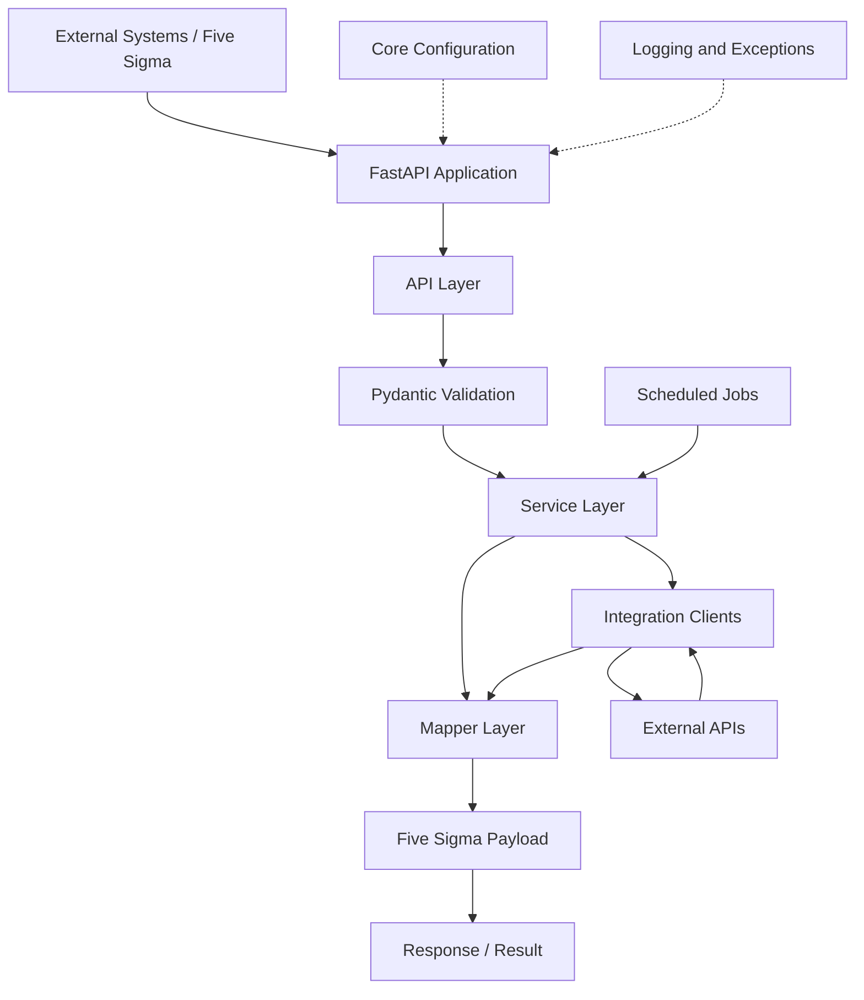
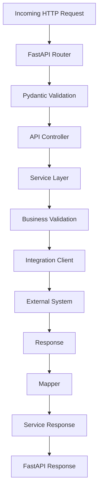
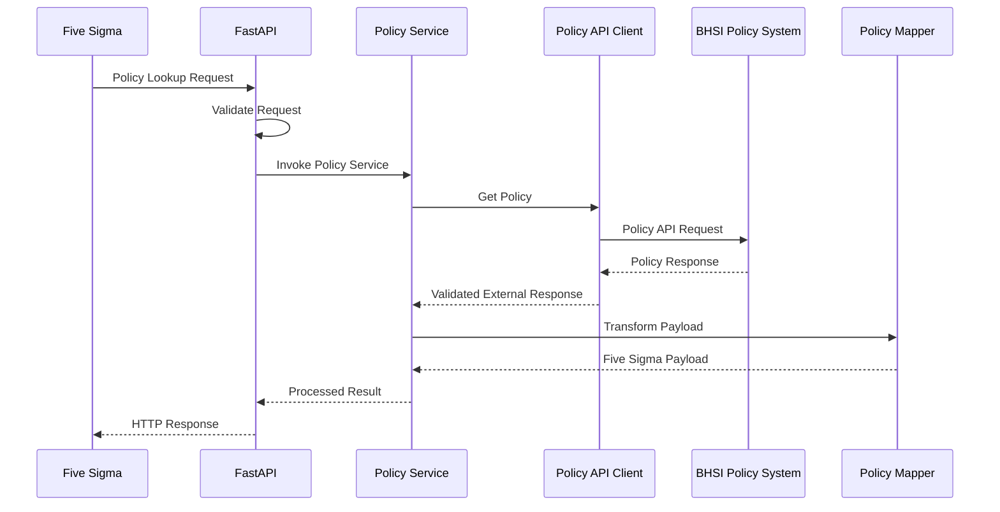

# Five Sigma – BHSI Integration Platform

## 1. Project Overview

### Introduction

The **Five Sigma BHSI Integration Platform** is an integration service designed to connect the Five Sigma Claims Management Platform with BHSI's external systems.

The application uses **FastAPI (Python)** to expose APIs, process integration requests, validate data, transform payloads and communicate with external systems.

Five Sigma acts as the core Claims Management System (CMS), while external systems provide supporting capabilities such as policy administration, payment processing and document management.

### Primary Objectives

- Integrate Five Sigma with BHSI's external systems.
- Retrieve and synchronize policy information.
- Support claim-related integrations.
- Process payment requests and responses.
- Integrate document management systems.
- Handle Five Sigma webhooks and claim events.
- Transform data between different system payload formats.
- Provide reliable, secure and maintainable API integrations.

---

## 2. High-Level Architecture

The application follows a modular, layered architecture.

Each layer has a specific responsibility to keep API handling, business logic, external communication and data transformation independent.

### Architecture Diagram



### Architecture Layers

| Layer | Responsibility |
|---|---|
| API Layer | Exposes HTTP endpoints using FastAPI |
| Schema Layer | Validates incoming and outgoing data using Pydantic |
| Service Layer | Handles business orchestration |
| Integration Layer | Communicates with Five Sigma and external systems |
| Mapper Layer | Transforms source and target payloads |
| Core Layer | Configuration, security, logging and exception handling |
| Jobs Layer | Handles scheduled background processing |
| Test Layer | Unit and integration testing |

---

## 3. Technology Stack

| Technology | Purpose |
|---|---|
| Python | Primary programming language |
| FastAPI | REST API framework |
| Pydantic | Request and response validation |
| HTTPX | HTTP communication with external APIs |
| Ruff | Linting, formatting and import sorting |
| MyPy | Static type checking |
| Pytest | Unit and integration testing |
| Pytest-Cov | Test coverage |
| Pre-commit | Automated code quality checks |
| Azure | Cloud hosting and supporting services |
| Azure Key Vault | Secure secret management |
| Azure Application Insights | Application monitoring |

---

## 4. Project Directory Structure

```text
xc/
│
├── .github/
│   └── workflows/
│       └── quality.yml
│
├── app/
│   ├── main.py
│   │
│   ├── api/
│   │   ├── router.py
│   │   └── v1/
│   │       ├── policy.py
│   │       ├── claims.py
│   │       ├── payments.py
│   │       ├── documents.py
│   │       └── webhooks.py
│   │
│   ├── core/
│   │   ├── config.py
│   │   ├── security.py
│   │   ├── logger.py
│   │   ├── exceptions.py
│   │   └── middleware.py
│   │
│   ├── dependencies/
│   │   └── clients.py
│   │
│   ├── integrations/
│   │   ├── five_sigma/
│   │   │   ├── client.py
│   │   │   └── auth.py
│   │   ├── policy_system/
│   │   │   └── client.py
│   │   ├── payment_provider/
│   │   │   └── client.py
│   │   └── document_system/
│   │       └── client.py
│   │
│   ├── mappers/
│   │   ├── policy_mapper.py
│   │   ├── claim_mapper.py
│   │   └── payment_mapper.py
│   │
│   ├── schemas/
│   │   ├── policy.py
│   │   ├── claim.py
│   │   ├── payment.py
│   │   └── document.py
│   │
│   ├── services/
│   │   ├── policy_service.py
│   │   ├── claim_service.py
│   │   ├── payment_service.py
│   │   └── document_service.py
│   │
│   └── utils/
│       └── validators.py
│
├── framework/
│   └── Shared framework Git submodule
│
├── jobs/
│   ├── payment_scheduler.py
│   └── retry_scheduler.py
│
├── tests/
│   ├── unit/
│   ├── integration/
│   ├── fixtures/
│   └── conftest.py
│
├── timer_function/
│   └── Azure Timer Function entry points (if retained)
│
├── docs/
│   ├── architecture.md
│   ├── integration_catalog.md
│   └── api_contracts/
│
├── static/
├── logs/
│
├── .env.example
├── .gitignore
├── .pre-commit-config.yaml
├── Dockerfile
├── pyproject.toml
├── requirements.txt
└── README.md
```

---

## 5. Folder Responsibilities

### 5.1 app/

Contains the main FastAPI application and its modules.

#### app/main.py

Application entry point.

Responsibilities:
- Initialize FastAPI.
- Register API routers.
- Configure application lifecycle.
- Register middleware and exception handlers.
- Expose health endpoints.

#### app/api/

Contains HTTP API endpoints.

Responsibilities:
- Receive incoming requests.
- Validate request data.
- Invoke appropriate services.
- Return HTTP responses.

API versioning is maintained under `api/v1/`.

#### app/core/

Contains application-wide functionality.

| File | Responsibility |
|---|---|
| config.py | Environment and application configuration |
| security.py | Authentication and authorization utilities |
| logger.py | Centralized logging |
| exceptions.py | Application exception definitions |
| middleware.py | Request processing middleware |

#### app/schemas/

Contains Pydantic models.

Responsibilities:
- Request validation.
- Response validation.
- Data type validation.
- Mandatory field validation.
- Payload structure validation.

#### app/services/

Contains business orchestration.

Responsibilities:
- Execute business workflows.
- Coordinate integration clients.
- Apply business-level validations.
- Handle integration responses.
- Invoke mappers when required.

Business logic should not be implemented directly inside API route handlers.

#### app/integrations/

Contains external system communication.

| Module | Responsibility |
|---|---|
| five_sigma/ | Five Sigma API communication |
| policy_system/ | Policy Administration System integration |
| payment_provider/ | Payment provider integration |
| document_system/ | Document management integration |

Each integration should encapsulate:
- API authentication.
- HTTP requests.
- Response handling.
- Timeout configuration.
- External API error handling.

#### app/mappers/

Responsible for transforming data between different systems.

Examples:
- BHSI policy response to Five Sigma policy payload.
- Internal claim representation to Five Sigma claim payload.
- Payment response to the required internal representation.

Mapping logic should remain separate from business processing.

#### app/dependencies/

Contains reusable FastAPI dependencies.

Examples:
- Shared HTTP clients.
- Service dependencies.
- Authentication dependencies.
- Configuration dependencies.

#### app/utils/

Contains reusable helper functions and validation utilities that do not belong to a specific business service.

---

### 5.2 framework/

Contains the shared framework maintained separately as a Git submodule.

Before adding new common functionality, check whether it already exists in the shared framework.

Avoid duplicating:
- Logger implementations.
- Common configuration utilities.
- Shared constants.
- Common exception handling.
- Reusable framework components.

---

### 5.3 jobs/

Contains scheduled processing logic.

Examples:
- Payment status polling.
- Failed integration retry processing.
- Scheduled synchronization.

Scheduling triggers should remain separate from business processing.

---

### 5.4 timer_function/

Contains Azure Timer Function entry points if the existing Azure Functions architecture is retained.

The timer function should trigger the corresponding job rather than contain all the business processing logic.

---

### 5.5 tests/

Contains automated tests.

| Directory | Responsibility |
|---|---|
| unit/ | Test individual functions and services |
| integration/ | Test communication and workflows across components |
| fixtures/ | Reusable test data |
| conftest.py | Shared Pytest fixtures |

---

## 6. Request Processing Workflow

All incoming HTTP requests follow a consistent application flow.



### Processing Steps

1. An external system sends an HTTP request.
2. FastAPI routes the request to the appropriate endpoint.
3. Pydantic validates the incoming request.
4. The endpoint invokes the relevant service.
5. The service performs business orchestration.
6. The integration client communicates with the external system.
7. The response is processed and transformed when required.
8. The service returns the result.
9. FastAPI sends the final HTTP response.

---

## 7. Integration Workflow – Policy Lookup (INT-01)

Policy Lookup is the initial integration workflow.

### Business Scenario

When an FNOL is created, Five Sigma requires policy information from BHSI's Policy Administration System.

### Architecture Flow



### Example Request

```json
{
  "policy_number": "POL-10001"
}
```

### Example Response

```json
{
  "policy_number": "POL-10001",
  "insured_name": "ABC Manufacturing",
  "status": "ACTIVE",
  "coverage_limit": 10000000
}
```

These are illustrative payloads. Actual fields and formats must follow the approved BHSI and Five Sigma API specifications.

### Implementation Responsibilities

| Component | Responsibility |
|---|---|
| policy.py | Expose policy lookup endpoint |
| schemas/policy.py | Validate policy request and response |
| policy_service.py | Orchestrate policy lookup |
| policy_system/client.py | Call BHSI Policy API |
| policy_mapper.py | Transform response |
| core/exceptions.py | Handle integration exceptions |

---

## 8. Integration Catalog

The Five Sigma integration catalog identifies the following integration points.

| ID | Integration | Purpose |
|---|---|---|
| INT-01 | Policy Lookup | Retrieve policy information |
| INT-02 | FNOL from Portal | Receive FNOL from external portal |
| INT-03 | Email FNOL | Receive FNOL through email |
| INT-04 | Single Sign-On | Identity provider integration |
| INT-05 | Claim Events | Send claim events through webhooks |
| INT-06 | Payments | Payment processing and status synchronization |
| INT-07 | Sanctions Screening | External screening integration |
| INT-08 | Documents | Document synchronization |
| INT-09 | Handoff | Transfer claims to another system (Model B) |
| INT-10 | Data Warehouse | Scheduled data export |

Not all integrations are necessarily part of the initial development scope. Implementation depends on the agreed project requirements and ownership matrix.

---

## 9. Error Handling and Reliability

External integrations can fail because of network issues, API downtime, invalid responses or authentication problems.

The application should handle these situations consistently.

### Error Handling Strategy

- Validate requests before calling external APIs.
- Configure connection and response timeouts.
- Handle HTTP errors.
- Log failures with correlation IDs.
- Avoid exposing internal exception details to external callers.
- Retry eligible transient failures.
- Prevent duplicate payment operations.
- Track webhook processing status.

### Example Error Categories

| Error | Handling |
|---|---|
| Invalid request | HTTP 422 |
| Authentication failure | HTTP 401/403 |
| External API timeout | Appropriate gateway/service error |
| External server error | Log and apply retry policy where safe |
| Business validation failure | Appropriate business error |
| Unexpected application error | HTTP 500 with internal logging |

Retries must be designed according to the operation's idempotency characteristics.

Payment creation and other non-idempotent operations must never be retried blindly.

---

## 10. Configuration Management

Application configuration should be environment-based.

Supported environments may include:

- Local
- Development
- QA
- UAT
- Production

### Configuration Files

| File | Purpose |
|---|---|
| .env | Local environment variables |
| .env.example | Example configuration without secrets |
| app/core/config.py | Load and validate application settings |
| requirements.txt | Runtime dependencies |
| pyproject.toml | Tool configuration |

### Secret Management

Sensitive information must not be committed to source control.

Production secrets should be managed using Azure Key Vault or the organization's approved secret management solution.

---

## 11. Development Setup

### Prerequisites

- Python 3.11+
- pip
- Git
- VS Code or another Python IDE
- Access to required API environments

### Step 1: Clone the repository

```bash
git clone <REPOSITORY_URL>

cd xc
```

If the shared framework is configured as a Git submodule:

```bash
git submodule update --init --recursive
```

### Step 2: Create virtual environment

```bash
python3 -m venv .venv

source .venv/bin/activate
```

### Step 3: Install dependencies

```bash
pip install -r requirements.txt
```

Install development dependencies if maintained separately:

```bash
pip install -r requirements-dev.txt
```

### Step 4: Configure environment

```bash
cp .env.example .env
```

Add the required local environment values.

### Step 5: Start application

```bash
uvicorn app.main:app --reload --port 8000
```

### Step 6: Access API documentation

Swagger:

http://127.0.0.1:8000/docs

ReDoc:

http://127.0.0.1:8000/redoc

Health endpoint:

http://127.0.0.1:8000/health

---

## 12. Code Quality and Validation

Ruff, MyPy and Pytest are used to maintain code quality.

### Ruff – Linting

```bash
ruff check .
```

Automatically fix supported issues:

```bash
ruff check . --fix
```

### Ruff – Formatting

```bash
ruff format .
```

Verify formatting:

```bash
ruff format . --check
```

### MyPy – Type Checking

```bash
mypy app
```

### Pytest – Unit and Integration Tests

```bash
pytest
```

### Coverage

```bash
pytest --cov=app --cov-report=html
```

The initial target coverage is 80%, subject to project quality requirements.

### Pre-commit

```bash
pre-commit install

pre-commit run --all-files
```

All validations should pass before submitting a pull request.

---

## 13. Testing Strategy

The application should follow a layered testing strategy.

### Unit Testing

Test individual components independently.

Examples:
- Policy validation.
- Claim processing.
- Payment processing.
- Payload mapping.
- Business rules.

### Integration Testing

Test communication between application modules and external systems.

Examples:
- FastAPI to Policy Service.
- Policy Service to BHSI PAS.
- FastAPI to Five Sigma API.
- Payment Service to Payment Provider.

Use mocks or approved sandbox environments rather than production services.

### Important Test Scenarios

- Valid policy lookup.
- Invalid policy number.
- Expired policy.
- External API timeout.
- External API unavailable.
- Invalid response payload.
- Payment success and failure.
- Duplicate payment request.
- Duplicate webhook event.
- Invalid webhook signature.

---

## 14. Security Considerations

Security must be applied across all integration points.

- Secure API credentials and tokens.
- Use HTTPS for external communication.
- Implement authentication and authorization.
- Validate incoming payloads.
- Verify webhook signatures.
- Prevent duplicate payment execution.
- Avoid logging sensitive customer information.
- Store secrets in approved secret management systems.
- Apply appropriate request size and rate limits.

---

## 15. Logging and Monitoring

The application should maintain structured logs for all important integration activities.

Recommended log fields:

- Timestamp.
- Correlation ID.
- Integration name.
- Request identifier.
- Operation.
- HTTP status.
- Execution duration.
- Processing status.
- Error details, with sensitive information masked.

Azure Application Insights can be used for centralized monitoring, tracing and alerting, subject to deployment configuration.

---

## 16. Deployment Architecture

The hosting model must be confirmed with the architecture lead.

The proposed deployment options are:

**Option A – FastAPI Hosting**

- Host FastAPI using Azure App Service or an approved container hosting service.
- Use Azure Key Vault for secrets.
- Use Application Insights for monitoring.

**Option B – FastAPI with Azure Functions**

- Use FastAPI for HTTP API handling.
- Retain Azure Timer Functions for scheduled jobs.
- Share business and integration services where appropriate.

Avoid duplicating HTTP entry points or business processing logic.

---

## 17. Development Guidelines

All developers should follow these guidelines:

1. Keep API endpoints lightweight.
2. Keep business logic inside service modules.
3. Keep external HTTP communication inside integration clients.
4. Keep request and response validation inside Pydantic schemas.
5. Keep payload transformations inside mapper modules.
6. Use dependency injection for reusable clients and services.
7. Use centralized exception handling.
8. Use structured logging and correlation IDs.
9. Write unit tests for new business logic.
10. Write integration tests for external API communication.
11. Run Ruff, MyPy and Pytest before raising pull requests.
12. Never commit credentials or environment-specific secrets.

---

## 18. New Developer Onboarding Checklist

A new developer should complete the following:

- [ ] Understand the Five Sigma platform and BHSI integration objectives.
- [ ] Understand the overall application architecture.
- [ ] Understand the purpose of each folder.
- [ ] Set up Python and the virtual environment.
- [ ] Install project dependencies.
- [ ] Configure local environment variables.
- [ ] Run the FastAPI application.
- [ ] Access Swagger documentation.
- [ ] Understand the Policy Lookup integration flow.
- [ ] Understand request and response mapping.
- [ ] Run unit and integration tests.
- [ ] Run Ruff and MyPy validations.
- [ ] Understand the Git branching and pull request process.

---

## 19. Important Project References

Developers should refer to the following resources before implementing integrations:

| Resource | Purpose |
|---|---|
| Five Sigma API documentation | API endpoints and integration contracts |
| docs/architecture.md | Application architecture |
| docs/integration_catalog.md | Integration inventory |
| docs/api_contracts/ | API request and response specifications |
| README.md | Development onboarding and architecture overview |
| Shared framework documentation | Reusable framework capabilities |

Five Sigma documentation:

https://docs.fivesigmalabs.com

---

## 20. Summary

The Five Sigma BHSI Integration Platform follows a modular architecture built around FastAPI.

The architecture separates:

- API communication.
- Request validation.
- Business orchestration.
- External system integrations.
- Data transformation.
- Configuration and security.
- Scheduled processing.
- Testing and monitoring.

This separation improves maintainability, testability, reusability and the ability to extend the platform with additional integrations.

**Primary development principle:**

Each module should have a clearly defined responsibility, and integrations should be loosely coupled so that changes in one external system do not unnecessarily impact the entire application.

---

**Document Ownership:** BHSI Integration Development Team

**Document Type:** Technical Architecture and Developer Onboarding

**Version:** 1.0

**Status:** Initial Architecture Documentation – Subject to confirmation against approved API specifications and deployment design.
