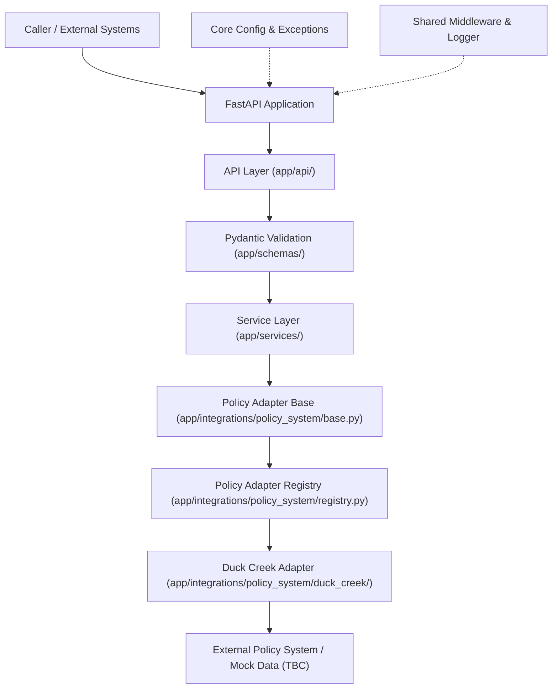

# Five Sigma – BHSI Integration Platform

## 1. Project Overview

### Introduction

The **Five Sigma BHSI Integration Platform** is a FastAPI-based integration middleware connecting the Five Sigma Claims Management Platform with BHSI's external enterprise systems and Policy Administration Systems (PAS).

The application exposes RESTful APIs, validates data, coordinates integration workflows, and abstracts external system communication through modular integration adapters.

**Current Policy System Status:**
- Rebuilt using the **Adapter Pattern**.
- **Duck Creek** is configured as the initial Policy Administration System.
- Current phase establishes the **file structure, classes, method signatures, schemas, and API route definitions** with empty method bodies (`pass` / `raise NotImplementedError`). No business logic or external HTTP calls are implemented yet.

### Primary Objectives

- Centralize integration between Five Sigma and BHSI external enterprise systems.
- Retrieve and synchronize policy information via the **Policy Adapter Pattern** (Duck Creek initial).
- Support claim, payment, document, and webhook integration workflows.
- Provide a consistent canonical schema for policy responses based strictly on confirmed requirements.
- Ensure easy extensibility so future PAS systems can be introduced without altering core API workflows.
- Enforce strict code quality via Ruff, MyPy, and Pytest.

---

## 2. High-Level Architecture

The application follows a modular, layered architecture with a clear separation of concerns.

### Architecture Diagram



### Architecture Layers

| Layer | Responsibility |
|---|---|
| **API Layer** (`app/api/`) | Exposes HTTP route definitions using FastAPI |
| **Schema Layer** (`app/schemas/`) | Validates incoming and outgoing payloads using Pydantic |
| **Service Layer** (`app/services/`) | Business workflow orchestration independent of specific providers |
| **Integration Layer** (`app/integrations/`) | External system adapters (Policy System / Duck Creek, Documents) |
| **Mapper Layer** (`app/mappers/`) | Dedicated transformation between provider and canonical formats |
| **Data Layer** (`app/data/`) | Mock data structures for development and testing (values TBC) |
| **Core Layer** (`app/core/`) | Shared configuration, security, logger, middleware, and error catalog |
| **Dependencies** (`app/dependencies/`) | FastAPI dependency injection providers for adapters and services |
| **Test Layer** (`tests/`) | Unit and integration test skeletons |

---

## 3. Technology Stack

| Technology | Purpose |
|---|---|
| Python 3.11+ | Primary programming language |
| FastAPI | REST API framework |
| Pydantic v2 | Request/response schemas and settings validation |
| HTTPX | Asynchronous HTTP client (for real external integration) |
| Ruff | Automated linting, code formatting, and import sorting |
| MyPy | Static type analysis in strict mode |
| Pytest & Pytest-Cov | Unit and integration testing |
| Azure Functions | Cloud serverless triggers (`function_app.py`) |

---

## 4. Project Directory Structure

```text
xc/
├── .github/
│   └── workflows/
│       └── quality.yml
│
├── app/
│   ├── main.py
│   │
│   ├── api/
│   │   ├── router.py
│   │   └── v1/
│   │       ├── health.py
│   │       └── policy.py
│   │
│   ├── core/
│   │   ├── config.py
│   │   ├── error_handlers.py
│   │   ├── exceptions.py
│   │   ├── logger.py
│   │   └── middleware.py
│   │
│   ├── data/
│   │   └── mock_data.py
│   │
│   ├── dependencies/
│   │   └── clients.py
│   │
│   ├── integrations/
│   │   ├── document_system/
│   │   └── policy_system/
│   │       ├── base.py
│   │       ├── config.py
│   │       ├── registry.py
│   │       └── duck_creek/
│   │           ├── adapter.py
│   │           └── config.py
│   │
│   ├── mappers/
│   │   └── policy_mapper.py
│   │
│   ├── schemas/
│   │   ├── errors.py
│   │   └── policy.py
│   │
│   └── services/
│       └── policy_service.py
│
├── docs/
│   ├── architecture.md
│   ├── integration_catalog.md
│   └── api_contracts/
│       ├── claim.yaml
│       ├── payment.yaml
│       └── policy.yaml
│
├── jobs/
│   ├── payment_scheduler.py
│   └── retry_scheduler.py
│
├── tests/
│   ├── conftest.py
│   ├── integration/
│   │   └── test_policy_api.py
│   └── unit/
│       ├── test_claim.py
│       ├── test_health.py
│       ├── test_payment.py
│       └── test_policy.py
│
├── timer_function/
│   ├── function.json
│   └── __init__.py
│
├── function_app.py
├── .env.example
├── .gitignore
├── pyproject.toml
├── requirements.txt
├── requirements-dev.txt
├── Understand.md
└── README.md
```

---

## 5. Policy Integration – Adapter Pattern

The Policy Integration is designed around the **Adapter Pattern** to isolate provider-specific logic from the core business workflows.

### 5.1 Abstract Base: `PolicyAdapterBase`
Located at `app/integrations/policy_system/base.py`, this abstract base class defines the contract required from any Policy Administration System:
- `search_policy(criteria: Any = None) -> Any`
- `get_policy(policy_id: str) -> Any`
- `get_coverages(policy_id: str) -> Any`

### 5.2 Adapter Registry: `PolicyAdapterRegistry`
Located at `app/integrations/policy_system/registry.py`, manages runtime registration and instantiation of policy system adapters.

### 5.3 Duck Creek Adapter: `DuckCreekAdapter`
Located at `app/integrations/policy_system/duck_creek/adapter.py`, implements `PolicyAdapterBase` for Duck Creek PAS. Methods are declared with empty bodies (`raise NotImplementedError` / `pass`).

### 5.4 Configuration Loaders
- `PolicySystemConfigLoader` (`app/integrations/policy_system/config.py`): Configuration loader for the general policy system.
- `DuckCreekConfigLoader` (`app/integrations/policy_system/duck_creek/config.py`): Configuration loader for Duck Creek connection parameters.

---

## 6. Policy Response Fields & Schemas

Defined in `app/schemas/policy.py`, the `PolicyResponse` schema strictly uses only confirmed fields from the reference requirements. Separate canonical entities (such as `PolicyVersion`, `Insured`, `Limit`, `Deductible`, or `SourceReference`) are excluded.

### Confirmed Fields:
- **Policy Identification & Dates:**
  - `Policy Number`
  - `Effective Date`
  - `Expiration Date`
  - `Currency`
  - `Policy State`
  - `Policy Holder Company`
- **Underwriting & Company Details:**
  - `UW Region`
  - `Writing Company`
  - `Booked As Value`
  - `Product Line/UW Area`
  - `Product Line Subtype`
  - `Section Code Name`
  - `ASL`
- **ISO Classifications & Codes:**
  - `Class Code (ISO)`
  - `Subline (ISO)`
  - `Deductible Codes (ISO)`
  - `Primary Involved Location Detail (ISO)`
- **Document Information:**
  - `Coverage/Exposure` (Coverage used instead of Line)
  - `Limits, Retentions`
  - `Dates, Retro Tail`

*Note: All field data types and JSON property names are marked `TBC` pending final interface specifications.*

---

## 7. Policy API Endpoints

The API routes are defined in `app/api/v1/policy.py` with empty function bodies:

| Method | Endpoint | Description |
|---|---|---|
| `POST` | `/policies/search` | Search policies based on criteria (TBC) |
| `GET` | `/policies/{id}` | Retrieve comprehensive details for a policy |
| `GET` | `/policies/{id}/coverages` | Retrieve coverage information for a policy |
| `GET` | `/health` | Application root health check |
| `GET` | `/api/v1/health` | Versioned API health check |

---

## 8. Error Catalog

Defined in `app/core/exceptions.py`, standardized domain exceptions map to confirmed integration error codes:

| Error Code | Exception Class | HTTP Status |
|---|---|---|
| `NOT_FOUND` | `PolicyNotFoundError` | 404 |
| `MULTIPLE_MATCHES` | `MultiplePoliciesFoundError` | 409 |
| `MAPPING_ERROR` | `PolicyMappingError` | 502 |
| `PAS_UNAVAILABLE` | `PASUnavailableError` | 503 |
| `TIMEOUT` | `PASTimeoutError` | 504 |

---

## 9. Current Implementation Status & TBC Items

The repository currently contains the **structural skeleton and signatures only**:
- **No business logic:** Methods contain only `pass` or `raise NotImplementedError`.
- **No HTTP API calls / mock retrieval:** No calls to external Duck Creek endpoints or database queries.
- **No invented fields:** Only confirmed fields are declared.
- **TBC Items:**
  1. Duck Creek API endpoints, authentication keys, and network timeouts.
  2. Exact JSON property naming casing (camelCase vs. snake_case) and primitive data types.
  3. Search request filter criteria parameters.
  4. Specific coverage response schema details.
  5. Azure Functions trigger configuration and execution bindings in `function_app.py`.

---

## 10. Development & Verification

### Running Checks

```bash
# Run Ruff linting and formatting checks
./.venv/bin/ruff check app tests function_app.py
./.venv/bin/ruff format --check app tests function_app.py

# Run static type checking in strict mode
./.venv/bin/mypy app tests function_app.py

# Run Pytest suite
./.venv/bin/pytest
```
