# Five Sigma – BHSI Integration Platform
# Technical Architecture Document

| Document Information | Details |
|---|---|
| Project | Five Sigma – BHSI Integration |
| Architecture | Modular, Layered Integration Architecture |
| Backend Framework | FastAPI |
| Programming Language | Python |
| API Communication | HTTPX |
| Validation | Pydantic |
| Cloud Platform | Microsoft Azure |
| Document Type | Technical Architecture |
| Version | 1.0 |
| Status | Proposed Architecture – Subject to Technical Review |

---

# 1. Introduction

## 1.1 Purpose

This document describes the technical architecture of the Five Sigma BHSI Integration Platform.

The objective is to establish a standardized integration architecture between Five Sigma Claims Management System (CMS) and BHSI's external enterprise systems.

The document is intended for:

- Backend developers.
- Integration developers.
- Solution architects.
- Technical leads.
- QA engineers.
- DevOps engineers.

It explains how the application is structured, how individual components communicate, how data flows between systems, and how new integrations should be implemented.

## 1.2 Business Context

Five Sigma is a cloud-based Claims Management System used to manage insurance claim operations.

The platform supports different claim management activities, including:

- First Notice of Loss (FNOL).
- Policy and coverage lookup.
- Claim creation and assignment.
- Investigation and reserves.
- Payments and recoveries.
- Documents and communications.
- Claim closure and handoff.
- Reporting and data export.

BHSI requires integration between Five Sigma and its external systems to exchange policy, payment, document and claim-related information.

Our integration application acts as the communication and transformation layer between these systems.

## 1.3 Architecture Objectives

The architecture should provide:

1. Separation of business logic and API communication.
2. Reusable integration clients.
3. Standardized request and response validation.
4. Consistent payload transformation.
5. Centralized exception handling.
6. Secure external API communication.
7. Reliable payment and webhook processing.
8. Configurable environment-specific settings.
9. Automated testing and code-quality validation.
10. Extensibility for future integrations.

---

# 2. System Architecture Overview

## 2.1 High-Level Architecture

The solution follows a modular, layered architecture.

FastAPI provides the HTTP application layer, while dedicated service and integration modules handle business orchestration and external system communication.

### Architecture Diagram

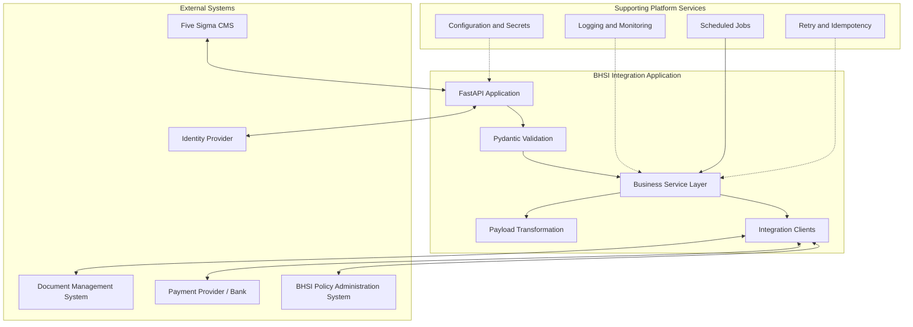

### Architecture Explanation

The architecture consists of the following major components.

| Component | Responsibility |
|---|---|
| Five Sigma CMS | Core claims management platform |
| FastAPI | Exposes and handles integration APIs |
| Pydantic | Validates request and response structures |
| Service Layer | Executes integration business workflows |
| Mapper Layer | Converts data between system formats |
| Integration Clients | Communicate with external APIs |
| Configuration | Manages environment-specific settings |
| Logging | Captures application and integration activities |
| Scheduled Jobs | Executes periodic processing |
| Retry and Idempotency | Handles transient failures and duplicate operations |

## 2.2 Architecture Principles

### Separation of Concerns

Each application module has a clearly defined responsibility.

For example:

- API endpoints should not contain business logic.
- Services should not directly manage HTTP request objects.
- Integration clients should not implement business decisions.
- Mappers should not perform external API calls.
- Configuration should not be hardcoded inside services.

### Loose Coupling

External system communication should be isolated behind dedicated integration clients.

If the BHSI Policy Administration System changes its API structure, the change should primarily affect its integration client and mapper rather than the entire application.

### Reusability

Common components should be reused across policy, claims, payments and document integrations.

### Configuration-Driven Design

URLs, credentials, timeout values and environment-specific parameters should be externally configurable.

---

# 3. Application Directory Structure

The application follows a modular structure organized by technical responsibility.

```text
xc/
│
├── .github/
│   └── workflows/
│       └── quality.yml
│
├── app/
│   ├── __init__.py
│   ├── main.py
│   │
│   ├── api/
│   │   ├── router.py
│   │   └── v1/
│   │       ├── policy.py
│   │       ├── claims.py
│   │       ├── payments.py
│   │       ├── documents.py
│   │       └── webhooks.py
│   │
│   ├── core/
│   │   ├── config.py
│   │   ├── security.py
│   │   ├── logger.py
│   │   ├── exceptions.py
│   │   └── middleware.py
│   │
│   ├── dependencies/
│   │   └── clients.py
│   │
│   ├── integrations/
│   │   ├── five_sigma/
│   │   │   ├── client.py
│   │   │   └── auth.py
│   │   ├── policy_system/
│   │   │   └── client.py
│   │   ├── payment_provider/
│   │   │   └── client.py
│   │   └── document_system/
│   │       └── client.py
│   │
│   ├── mappers/
│   │   ├── policy_mapper.py
│   │   ├── claim_mapper.py
│   │   └── payment_mapper.py
│   │
│   ├── schemas/
│   │   ├── policy.py
│   │   ├── claim.py
│   │   ├── payment.py
│   │   └── document.py
│   │
│   ├── services/
│   │   ├── policy_service.py
│   │   ├── claim_service.py
│   │   ├── payment_service.py
│   │   └── document_service.py
│   │
│   └── utils/
│       └── validators.py
│
├── framework/
│
├── jobs/
│   ├── payment_scheduler.py
│   └── retry_scheduler.py
│
├── timer_function/
│
├── tests/
│   ├── unit/
│   ├── integration/
│   ├── fixtures/
│   └── conftest.py
│
├── docs/
│   ├── architecture.md
│   ├── integration_catalog.md
│   └── api_contracts/
│
├── static/
├── logs/
│
├── .env.example
├── .gitignore
├── .pre-commit-config.yaml
├── Dockerfile
├── pyproject.toml
├── requirements.txt
└── README.md
```

---

# 4. Component-Level Architecture

## 4.1 Application Entry Point – app/main.py

This is the main entry point of the FastAPI application.

Responsibilities:

- Initialize the FastAPI instance.
- Register application routers.
- Configure application lifecycle.
- Register global exception handlers.
- Register middleware.
- Initialize shared HTTP clients.
- Expose application health endpoints.

Example:

```python
from fastapi import FastAPI

from app.api.router import api_router
from app.core.config import settings

app = FastAPI(
    title=settings.app_name,
    version="1.0.0",
)

app.include_router(
    api_router,
    prefix="/api/v1",
)


@app.get("/health")
async def health_check():
    return {"status": "healthy"}
```

Application initialization should use FastAPI's lifespan mechanism for resources that need startup and shutdown management.

## 4.2 API Layer – app/api/

The API layer handles incoming HTTP requests.

It acts as the entry point for integration workflows.

Responsibilities:

- Define HTTP endpoints.
- Validate incoming request models.
- Invoke service methods.
- Return standardized responses.
- Apply route-level security requirements.

Example endpoints:

| Module | Example Endpoint | Purpose |
|---|---|---|
| policy.py | POST /api/v1/policies/lookup | Retrieve policy information |
| claims.py | POST /api/v1/claims | Process claim requests |
| payments.py | POST /api/v1/payments | Process payment operations |
| documents.py | POST /api/v1/documents | Handle document operations |
| webhooks.py | POST /api/v1/webhooks/claims | Receive claim events |

The API layer should remain lightweight.

It should delegate business processing to the service layer.

## 4.3 Schema Layer – app/schemas/

This layer defines Pydantic request and response models.

Responsibilities:

- Validate mandatory fields.
- Validate field types.
- Apply field constraints.
- Reject unexpected fields where appropriate.
- Define API response structures.

Example:

```python
from pydantic import BaseModel, ConfigDict, Field


class PolicyRequest(BaseModel):

    model_config = ConfigDict(extra="forbid")

    policy_number: str = Field(
        min_length=1,
        max_length=50,
    )
```

Validation should happen before business processing.

External system response validation should also be implemented using dedicated models where practical.

## 4.4 Service Layer – app/services/

The service layer contains application-specific business orchestration.

It coordinates integration clients, validators and mappers.

Responsibilities:

- Execute business workflows.
- Coordinate multiple external systems.
- Apply business rules.
- Handle service-level errors.
- Invoke mapping operations.
- Return processed results.

Example:

```python
class PolicyService:

    def __init__(self, policy_client, policy_mapper):
        self.policy_client = policy_client
        self.policy_mapper = policy_mapper

    async def lookup_policy(self, policy_number: str):

        response = await self.policy_client.get_policy(
            policy_number
        )

        return self.policy_mapper.to_five_sigma(
            response
        )
```

The service layer should not depend on FastAPI-specific request or response objects.

This allows the same business logic to be reused by HTTP endpoints and scheduled jobs.

## 4.5 Integration Layer – app/integrations/

This layer communicates with external systems.

Each external system should have an independent client.

### Five Sigma Client

Responsible for:

- Five Sigma API authentication.
- Sending API requests.
- Handling Five Sigma responses.
- Managing API-specific headers.
- Applying timeout and error handling.

### Policy System Client

Responsible for:

- Calling BHSI Policy Administration APIs.
- Retrieving policy information.
- Handling policy API responses.
- Managing authentication and connectivity.

### Payment Provider Client

Responsible for:

- Sending payment instructions.
- Retrieving payment status.
- Processing payment responses.
- Handling provider-specific errors.

### Document System Client

Responsible for:

- Uploading or retrieving documents.
- Exchanging document metadata.
- Handling document API responses.

External API contracts must be documented independently.

## 4.6 Mapper Layer – app/mappers/

The mapper layer converts data between systems.

Different systems may represent the same business information using different field names, formats and structures.

Example:

BHSI response:

```json
{
  "policyNumber": "POL-10001",
  "insuredName": "ABC Manufacturing",
  "coverageAmount": 10000000
}
```

Five Sigma payload:

```json
{
  "policy_number": "POL-10001",
  "insured_name": "ABC Manufacturing",
  "coverage_limit": 10000000
}
```

The mapper is responsible for transforming one structure into the other.

Mapping logic should be independently testable.

## 4.7 Core Layer – app/core/

Contains shared application-level functionality.

| File | Responsibility |
|---|---|
| config.py | Application settings |
| security.py | Authentication and authorization |
| logger.py | Structured logging |
| exceptions.py | Custom exception classes |
| middleware.py | Request-level middleware |

This layer should not contain policy-specific or payment-specific business logic.

## 4.8 Dependencies – app/dependencies/

Contains reusable dependency providers.

Examples:

- HTTP client instances.
- Service instances.
- Configuration providers.
- Authentication dependencies.

FastAPI dependency injection should be used to provide reusable components to endpoints.

## 4.9 Shared Framework – framework/

Contains the shared framework maintained separately by the architecture team.

Before implementing reusable functionality, review this framework.

Avoid duplicating existing functionality such as:

- Shared logging.
- Configuration utilities.
- Common constants.
- Reusable transformation components.
- Common exceptions.

The shared framework should be treated as an independently versioned dependency.

---

# 5. Business Operating Models

Five Sigma supports two common operating models.

The selected model determines where claims are processed and which integrations are required.

## 5.1 Model A – End-to-End Processing in Five Sigma

In this model, Five Sigma acts as the Claims System of Record.

The complete claim lifecycle is managed within Five Sigma.

Responsibilities include:

- FNOL intake.
- Policy lookup.
- Claim setup.
- Assignment.
- Investigation.
- Reserves.
- Payments and recoveries.
- Claim closure.

### Architecture

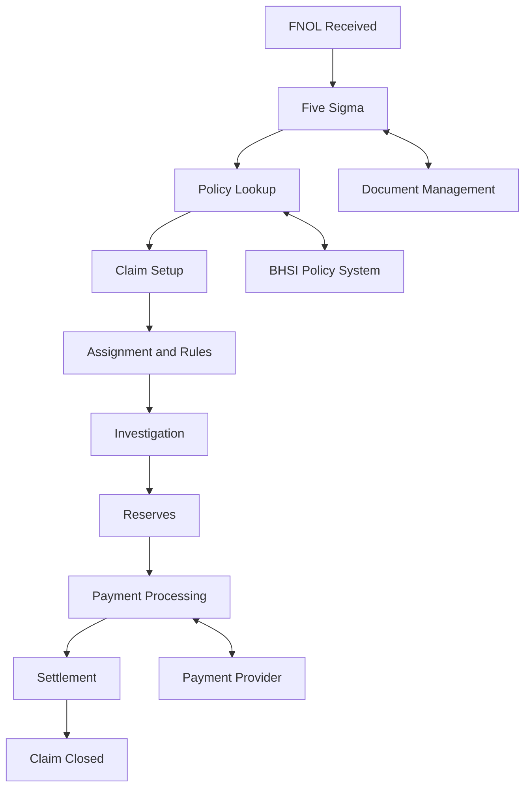

### Integration Responsibilities

- Policy information is retrieved from the policy system.
- Claim information is managed in Five Sigma.
- Payment instructions are sent to the agreed payment provider.
- Payment status is synchronized.
- Documents are exchanged when required.
- Claim data may be exported to the customer data warehouse.

## 5.2 Model B – Intake in Five Sigma, Handoff to Another System

In this model, Five Sigma manages FNOL intake and initial claim setup.

The claim is subsequently transferred to the customer's system of record.

Responsibilities include:

- FNOL intake.
- Policy lookup.
- Required field validation.
- Duplicate detection.
- Data formatting.
- Claim handoff.
- Handoff status tracking.

### Architecture

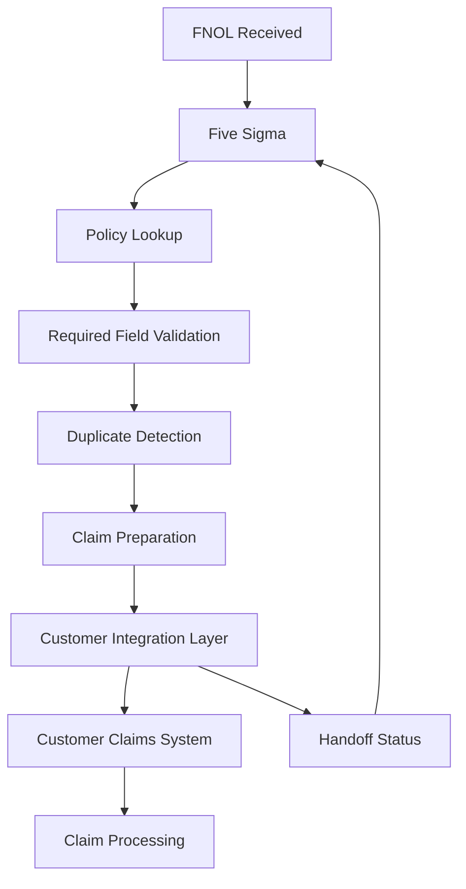

### Integration Responsibilities

- Retrieve policy information.
- Validate claim details.
- Transform claim data into the receiving system's format.
- Transfer claim information.
- Handle failed handoffs.
- Track delivery and response status.

The exact handoff and retry behavior must be agreed with the customer.

---

# 6. Claim Data Hierarchy and Business Configuration

Five Sigma uses a configurable business hierarchy.

The hierarchy determines how claims are organized and how configuration is applied.

## 6.1 Hierarchy

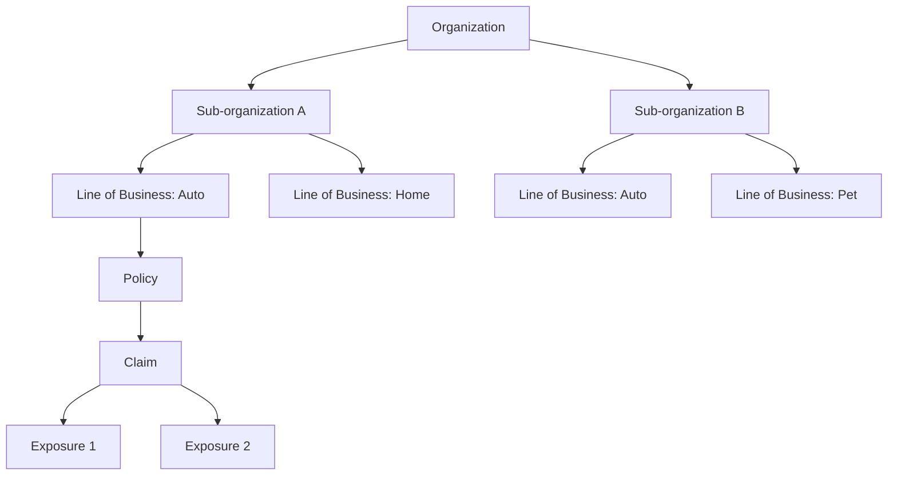

## 6.2 Organization

Represents the overall customer or business configuration.

Configuration can include:

- Customer-level settings.
- General application behavior.
- Organization-level access.
- Global configuration defaults.

## 6.3 Sub-organization

Represents a business grouping within an organization.

Depending on the customer configuration, it may represent:

- Broker.
- Region.
- Business unit.
- Program.
- Partner.

In the Tego implementation discussed during knowledge transfer, sub-organization was understood to correspond to the broker context.

This mapping must be confirmed independently for BHSI.

### Why Sub-organizations Are Important

They allow different business groups to have separate configurations.

Examples:

- Different claim assignment rules.
- Different FNOL requirements.
- Different notifications.
- Different claim handling workflows.

## 6.4 Line of Business

Represents the insurance product or business category.

Examples:

- Auto.
- Home.
- Pet.
- Commercial Property.
- General Liability.

Different lines of business may require different:

- FNOL fields.
- Validation rules.
- Assignment rules.
- Exposure configurations.
- Templates.
- Reserve defaults.

## 6.5 Policy

Represents the insurance policy associated with a claim.

Policy information is retrieved through the agreed policy integration.

The policy record can provide:

- Policy number.
- Insured information.
- Coverage details.
- Effective dates.
- Expiry dates.
- Policy status.

The exact fields depend on the external policy system and Five Sigma contract.

## 6.6 Claim

Represents the reported insurance loss.

A claim is associated with the applicable organization, sub-organization, line of business and policy.

## 6.7 Exposure

Represents an individual financial or loss component within a claim.

A claim may contain multiple exposures.

Examples include:

- Property damage.
- Bodily injury.
- Liability.
- Other covered loss categories.

The exposure structure depends on the applicable claim configuration.

---

# 7. End-to-End Claim Workflow

The claim workflow describes how a claim enters the system and moves through its lifecycle.

## 7.1 Ways In – FNOL Channels

FNOL information can enter Five Sigma through different channels.

| Channel | Description |
|---|---|
| FNOL Email | FNOL received through configured email inboxes |
| FNOL API | External portal or partner sends an API request |
| FNOL Form | Claimant or claims team enters information |
| Phone | Claim information captured from a phone call |
| SMS | Claim-related information received through messaging |
| Video | Information received through a supported video process |

## 7.2 FNOL Processing

The general workflow is:

1. Receive FNOL.
2. Identify the organization and sub-organization.
3. Identify the line of business.
4. Retrieve policy information.
5. Validate required fields.
6. Check for duplicate claims.
7. Create the claim.
8. Generate applicable exposures.
9. Execute assignment and notification rules.
10. Continue the claim lifecycle.

## 7.3 Claim Lifecycle

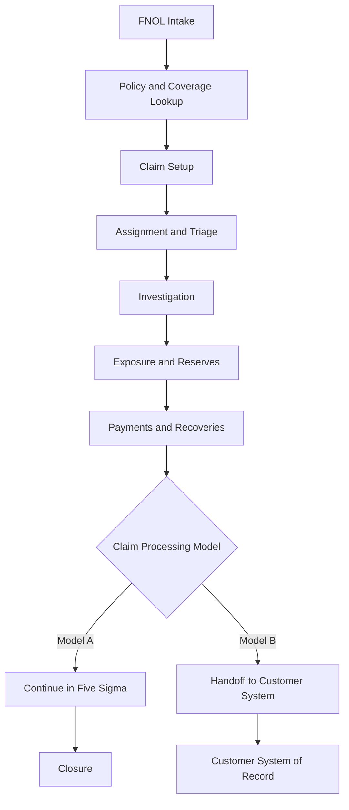

The detailed workflow, rules and available screens are configured within Five Sigma and should not be duplicated unnecessarily in the integration application.

---

# 8. Integration Architecture

The integration layer connects Five Sigma with customer systems.

## 8.1 Integration Catalog

The integration catalog identifies the major integration points.

| ID | Integration | Direction | Mechanism |
|---|---|---|---|
| INT-01 | Policy Lookup | Policy System → Five Sigma | Policy API |
| INT-02 | FNOL from Portal | Portal → Five Sigma | REST API |
| INT-03 | Email FNOL | Email → Five Sigma | Email processing |
| INT-04 | Single Sign-On | Identity Provider → Five Sigma | OpenID Connect / SSO |
| INT-05 | Claim Events | Five Sigma → Customer Systems | Signed Webhooks |
| INT-06 | Payments | Five Sigma ↔ Payment Provider | API / Scheduled Processing |
| INT-07 | Sanctions Screening | Five Sigma ↔ Screening Service | API / Configured Integration |
| INT-08 | Documents | Five Sigma ↔ Document System | APIs / Webhooks |
| INT-09 | Handoff | Five Sigma → Customer System | Customer Integration Layer |
| INT-10 | Data Warehouse | Five Sigma → Customer Storage | Scheduled Export |

The actual mechanism and implementation ownership must be confirmed for each integration.

## 8.2 Integration Ownership

Integrations may be built and operated by:

### Option A – Five Sigma Professional Services

Five Sigma Professional Services builds and operates the integration through the Five Sigma integration layer.

Capabilities may include:

- APIs.
- Webhooks.
- Data imports.
- Data exports.
- Scheduled integrations.
- Transformations.
- Cloud functions.
- SFTP connections.
- Monitoring.

### Option B – Customer IT / Systems Integrator

The customer or systems integrator builds and operates its own middleware.

The middleware communicates with Five Sigma APIs and webhooks.

The integration ownership model should be documented separately for every integration.

---

# 9. Integration Design Standards

Every integration should have a documented contract.

The following eight questions should be answered before implementation.

## 9.1 Trigger

What starts the integration?

Examples:

- FNOL creation.
- Claim creation.
- Claim update.
- Payment approval.
- Scheduled execution.
- Document upload.

## 9.2 Fields

Which fields are sent and returned?

Document:

- Mandatory fields.
- Optional fields.
- Data types.
- Field mapping.
- Null handling.
- Default values.

## 9.3 Failures

What happens when an API call fails?

Document:

- Timeout behavior.
- Retry policy.
- Error mapping.
- Alerting.
- Failed request tracking.

## 9.4 Duplicates

How are duplicate requests identified?

Use a unique request or event identifier and an agreed idempotency strategy.

## 9.5 Data Returned

Which policy, coverage, payment or claim fields are returned?

Define how those fields are mapped into the receiving system.

## 9.6 Documents

Which documents are transferred?

Document:

- Document types.
- Metadata.
- File formats.
- File size limits.
- Storage references.
- Ownership.

## 9.7 Later Changes

What happens when information changes after the original integration?

Examples:

- Policy cancellation.
- Policy endorsement.
- Claim updates.
- Payment status updates.
- Document replacement.

## 9.8 Owners

Identify who owns:

- API development.
- Infrastructure.
- Authentication.
- Monitoring.
- Production support.
- Incident management.

---

# 10. Detailed Integration Workflows

## 10.1 INT-01 – Policy Lookup

### Business Objective

Retrieve policy details from BHSI's Policy Administration System and make the information available to Five Sigma.

### Workflow

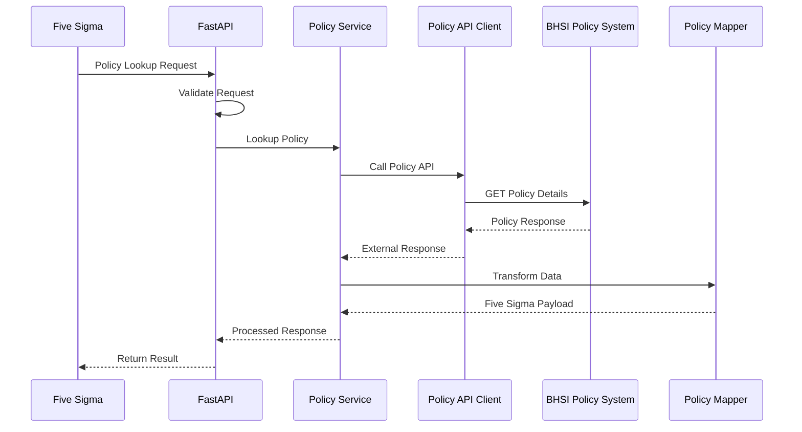

### Responsibilities

- FastAPI receives the policy request.
- Pydantic validates the request.
- Policy Service orchestrates the workflow.
- Policy Client communicates with BHSI PAS.
- Policy Mapper transforms the response.
- The result is returned in the agreed Five Sigma format.

### Important Considerations

- Validate the policy number.
- Handle policy-not-found scenarios.
- Handle expired or cancelled policies according to business rules.
- Validate external response fields.
- Log the integration using a correlation ID.
- Avoid logging sensitive insured information.

## 10.2 INT-05 – Claim Events

### Business Objective

Send claim lifecycle events from Five Sigma to customer systems.

### Workflow

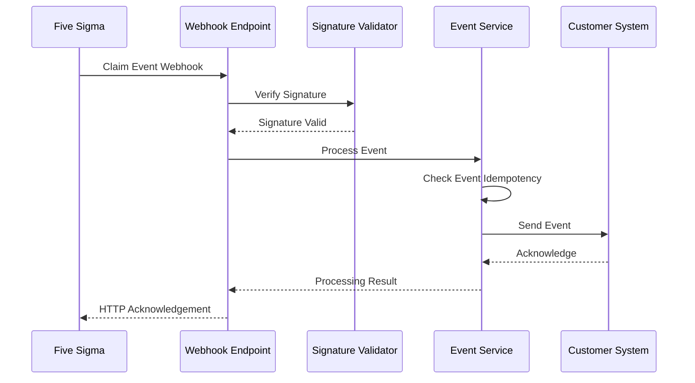

### Responsibilities

- Receive event payloads.
- Verify webhook signatures.
- Validate event structures.
- Detect duplicate events.
- Process or queue events.
- Track delivery status.
- Handle retry scenarios.

The HTTP acknowledgement strategy should be agreed with Five Sigma. For long-running operations, durable asynchronous processing is preferable to holding an HTTP request open.

## 10.3 INT-06 – Payments

### Business Objective

Support payment processing and synchronization between Five Sigma and the payment provider.

### Workflow

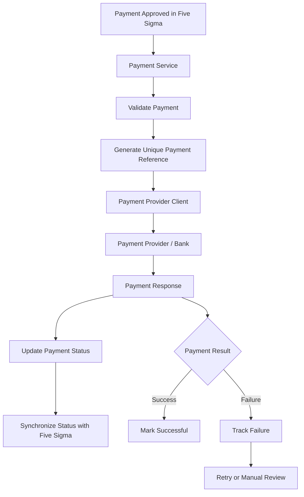

### Responsibilities

- Validate payment information.
- Ensure duplicate payment prevention.
- Submit payment requests.
- Track provider references.
- Synchronize payment status.
- Handle provider failures.
- Support reconciliation.

### Important Considerations

Payment operations require stronger reliability controls.

A payment request must have a unique business reference.

Retries must use the provider's idempotency capabilities where available. A timeout does not prove that a payment failed; the application should reconcile its status before attempting another payment.

## 10.4 INT-08 – Documents

### Business Objective

Exchange claim-related documents between Five Sigma and the document management system.

### Workflow

1. A document is created or uploaded.
2. The document metadata is validated.
3. The integration determines the target system.
4. The document is transferred using the agreed API.
5. The receiving system returns a document reference.
6. The document status and reference are recorded.

Important considerations:

- File type validation.
- File size restrictions.
- Secure transfer.
- Document metadata mapping.
- Duplicate upload prevention.
- Access control.

## 10.5 INT-10 – Data Warehouse Export

### Business Objective

Transfer claim-related information to customer reporting and analytical systems.

The export can be scheduled or implemented using an agreed integration mechanism.

Important considerations:

- Export frequency.
- Data selection.
- Incremental versus full export.
- Data format.
- Encryption.
- Failure tracking.
- Reconciliation.

A scheduled export should not be treated as a real-time API replacement.

---

# 11. Request Processing Architecture

## 11.1 Standard Request Lifecycle

Every incoming API request should follow a standardized processing lifecycle.

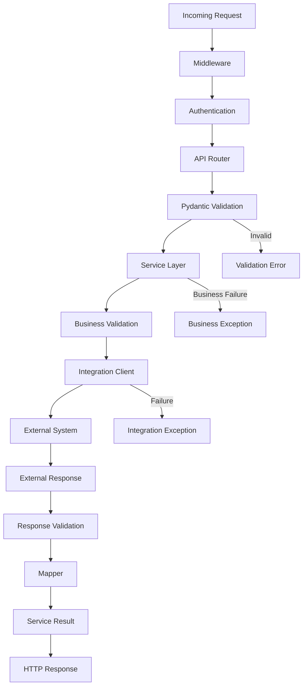

## 11.2 Middleware Responsibilities

Middleware can handle:

- Correlation ID propagation.
- Request timing.
- Request-level logging.
- Security-related headers.
- Request tracing.

Middleware should avoid logging complete request bodies by default because they may contain sensitive insurance information.

## 11.3 Request and Response Models

Use Pydantic models to validate external and internal data contracts.

Do not assume that a successful HTTP status means that the returned payload is valid.

Both transport-level and data-level validation are required.

---

# 12. Error Handling Architecture

External integrations can fail for several reasons.

The application should use a centralized exception-handling strategy.

## 12.1 Error Categories

| Category | Example | Handling |
|---|---|---|
| Validation Error | Missing policy number | Reject request |
| Authentication Error | Invalid API token | Authentication failure |
| Authorization Error | Insufficient permissions | Access denied |
| Not Found | Policy does not exist | Business-level not-found response |
| Timeout | External system not responding | Retry only where safe |
| External Server Error | HTTP 500 | Transient failure handling |
| Mapping Error | Invalid external response structure | Log and reject processing |
| Business Error | Invalid claim state | Return business error |
| Unexpected Error | Unhandled exception | Centralized HTTP 500 handling |

## 12.2 Exception Structure

Recommended exception hierarchy:

```text
ApplicationException
│
├── ValidationException
│
├── AuthenticationException
│
├── AuthorizationException
│
├── BusinessException
│
├── IntegrationException
│   ├── IntegrationTimeoutException
│   ├── ExternalAPIException
│   └── IntegrationMappingException
│
└── InternalServerException
```

The actual implementation should be aligned with existing shared framework exceptions.

## 12.3 Retry Strategy

Retry should be applied only to appropriate transient failures.

Examples:

- Connection timeout.
- Temporary network failure.
- HTTP 429, respecting Retry-After.
- Selected HTTP 5xx responses.

Avoid retrying:

- Invalid requests.
- Authentication failures.
- Business validation errors.
- Non-idempotent operations without duplicate protection.

A bounded exponential backoff strategy can be used where appropriate.

---

# 13. Idempotency and Duplicate Prevention

Idempotency ensures that processing the same logical request multiple times does not create duplicate business operations.

This is particularly important for payments and claim events.

### Example

A payment request is submitted, but the response is lost because of a network timeout.

The client submits the same request again.

Without idempotency, the payment provider may process the payment twice.

### Recommended Approach

1. Generate or receive a unique idempotency key.
2. Associate it with the business operation.
3. Check whether the operation has already been processed.
4. Return the previously recorded result where appropriate.
5. Prevent concurrent duplicate execution.
6. Reconcile uncertain payment outcomes with the provider.

A persistent store or the payment provider's own idempotency mechanism is required for reliable production behavior.

---

# 14. Security Architecture

Security is required across every integration boundary.

## 14.1 Authentication

The application may need to support:

- API key authentication.
- OAuth 2.0 client credentials.
- OpenID Connect.
- Service-to-service authentication.
- Webhook signature verification.

The actual mechanism depends on the relevant Five Sigma and external API contracts.

## 14.2 Authorization

Only authorized clients and users should be able to invoke protected operations.

Permissions should be applied at the appropriate API and business-operation levels.

## 14.3 Secrets Management

Do not hardcode:

- API keys.
- Client secrets.
- Access tokens.
- Passwords.
- Private keys.

Use environment-based configuration for local development and Azure Key Vault or the approved enterprise secret store for production.

## 14.4 Webhook Security

Webhook endpoints should implement:

- Signature verification.
- Timestamp validation where supported.
- Replay protection.
- Duplicate event detection.
- Secure transport.

## 14.5 Sensitive Data

Insurance applications may handle personally identifiable and confidential business information.

Therefore:

- Mask sensitive data in logs.
- Avoid logging complete payloads.
- Apply access restrictions.
- Encrypt data in transit.
- Follow BHSI retention and security requirements.

---

# 15. Configuration Management

Configuration should be environment-driven.

## 15.1 Supported Environments

| Environment | Purpose |
|---|---|
| Local | Developer workstation |
| Development | Initial development testing |
| QA | Quality assurance |
| UAT | Business acceptance testing |
| Production | Live integration processing |

## 15.2 Configuration Responsibilities

`app/core/config.py` should load and validate:

- Application name.
- Environment.
- External API URLs.
- Authentication settings.
- Timeout values.
- Logging levels.
- Feature flags where applicable.

## 15.3 Configuration Sources

| Source | Usage |
|---|---|
| .env | Local development |
| Azure App Settings | Deployment configuration |
| Azure Key Vault | Sensitive credentials |
| pyproject.toml | Development tooling configuration |

Environment-specific configuration should not be duplicated across business services.

---

# 16. Background and Scheduled Processing

Some integrations do not require immediate execution.

Examples:

- Payment status synchronization.
- Retry processing.
- Scheduled data exports.
- Reconciliation.

## 16.1 Jobs Architecture

The `jobs/` directory contains reusable job processing logic.

```text
jobs/
│
├── payment_scheduler.py
└── retry_scheduler.py
```

## 16.2 Timer Function Architecture

If Azure Timer Functions are retained, they should trigger the corresponding jobs.

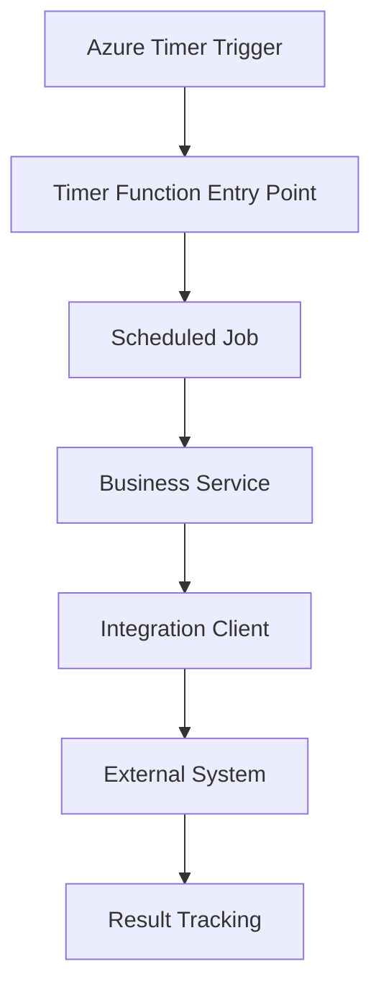

The Timer Function should not duplicate business logic already implemented in the service layer.

## 16.3 Background Processing Considerations

- Avoid overlapping scheduled executions.
- Track job execution status.
- Handle partial failures.
- Implement safe retries.
- Ensure duplicate prevention.
- Log execution duration.
- Support operational monitoring.

For high-volume asynchronous processing, a durable queue-based architecture may be required. The choice of queue technology should be confirmed with the architecture team.

---

# 17. External API Communication Standards

All outbound HTTP communication should use a consistent integration-client approach.

HTTPX is the recommended HTTP library for asynchronous requests.

## 17.1 Client Responsibilities

- Configure base URLs.
- Configure connection and response timeouts.
- Apply authentication headers.
- Send requests.
- Validate response status.
- Handle network errors.
- Parse response payloads.
- Close resources correctly.

## 17.2 Connection Management

Use reusable HTTP clients with application lifecycle management.

Avoid creating a new connection pool for every individual request.

## 17.3 API Timeout

Timeouts should be configurable for each integration.

Different operations may require different timeout values.

## 17.4 External Response Handling

A response should pass through:

1. HTTP status validation.
2. JSON parsing.
3. Schema validation.
4. Business-level validation.
5. Payload mapping.

---

# 18. Data Ownership and System of Record

The system of record depends on the operating model.

## 18.1 Model A – End-to-End in Five Sigma

| Data | System of Record |
|---|---|
| Policy | Policy Administration System |
| Claims and Exposures | Five Sigma |
| Reserves | Five Sigma |
| Payments | Five Sigma for approval and payment tracking; provider for execution status |
| Documents and Communications | Five Sigma claim file, with external storage where required |
| Users and Access | Five Sigma and configured identity provider |
| Reporting Data | Five Sigma and customer data warehouse |

## 18.2 Model B – Handoff to Customer System

| Data | System of Record |
|---|---|
| Policy | Policy Administration System |
| Claims after handoff | Customer Claims System |
| Intake information | Five Sigma until handoff, subject to agreed ownership |
| Documents | Agreed customer document system |
| Payment information | Customer system and payment provider, according to design |
| Reporting Data | Customer data warehouse |

Ownership must be formally agreed before integration development.

---

# 19. Logging, Monitoring and Observability

Observability is important for identifying integration failures and troubleshooting production issues.

## 19.1 Structured Logging

Each important integration operation should capture:

- Timestamp.
- Correlation ID.
- Integration ID.
- Operation name.
- Source system.
- Target system.
- Processing status.
- HTTP status code.
- Execution duration.
- Sanitized error details.

## 19.2 Correlation ID

A correlation ID should be propagated through the application and outbound integration calls where supported.

This helps trace a complete transaction across multiple systems.

## 19.3 Monitoring

Azure Application Insights can provide:

- Application telemetry.
- Request monitoring.
- Exception tracking.
- Dependency tracking.
- Performance monitoring.
- Alerts.

## 19.4 Important Operational Metrics

Recommended metrics:

- Total requests.
- Successful requests.
- Failed requests.
- External API latency.
- Timeout count.
- Retry count.
- Duplicate event count.
- Payment processing status.
- Scheduled job failures.

---

# 20. Testing Architecture

The application should follow a layered testing approach.

## 20.1 Unit Tests

Location:

```text
tests/unit/
```

Test individual components independently.

Examples:

- Policy validation.
- Payment business rules.
- Claim processing.
- Payload mapping.
- Error handling.
- Idempotency logic.

## 20.2 Integration Tests

Location:

```text
tests/integration/
```

Test interactions between multiple components.

Examples:

- FastAPI to Policy Service.
- Policy Service to BHSI PAS client.
- Service to mapper.
- Webhook processing.
- Payment status synchronization.

Use mocked external dependencies for deterministic tests and approved sandbox environments for actual external API contract testing.

## 20.3 Test Coverage

Pytest-Cov provides coverage reporting.

Initial target:

80% coverage, subject to project requirements.

High-priority areas:

- Payment operations.
- Policy integration.
- Payload transformation.
- Error handling.
- Webhook processing.

---

# 21. Code Quality and Development Standards

The project uses automated development tools.

| Tool | Responsibility |
|---|---|
| Ruff | Linting and formatting |
| MyPy | Static type checking |
| Pytest | Automated testing |
| Pytest-Cov | Coverage |
| Pre-commit | Git commit validation |

## 21.1 Ruff

```bash
ruff check .
ruff check . --fix
ruff format .
ruff format . --check
```

## 21.2 MyPy

```bash
mypy app
```

## 21.3 Pytest

```bash
pytest
```

## 21.4 Coverage

```bash
pytest --cov=app --cov-report=html
```

All quality checks should be executed during the CI pipeline.

---

# 22. CI/CD Architecture

The application should follow an automated build and validation process.

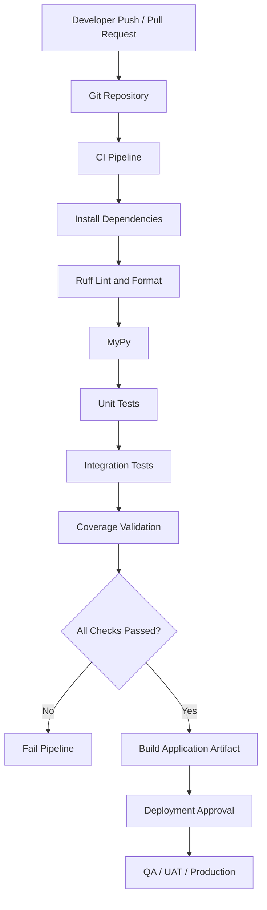

## 22.1 Pipeline Responsibilities

- Install application dependencies.
- Validate code formatting.
- Execute static type checks.
- Run unit tests.
- Run integration tests.
- Generate coverage reports.
- Build the deployment artifact.
- Deploy to the approved environment.

Production deployments should follow the organization's release and approval process.

---

# 23. Deployment Architecture

The hosting model must be finalized with the architecture lead.

## Option A – FastAPI on Azure App Service or Container Hosting

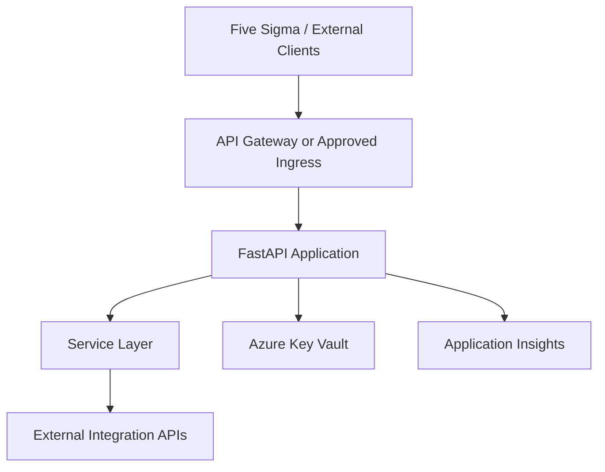

This model provides a dedicated FastAPI hosting environment.

## Option B – FastAPI with Azure Timer Functions

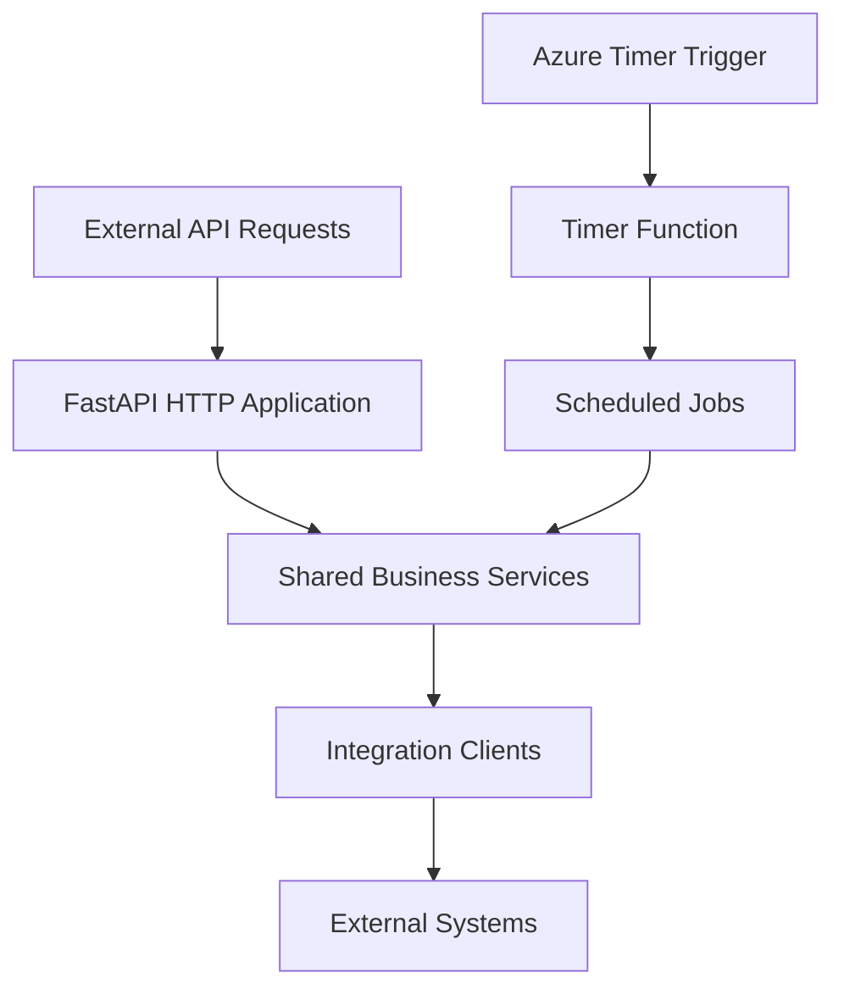

This model retains Azure Functions for scheduled execution while sharing business services.

The two models should not be combined without clearly defining hosting, deployment and operational responsibilities.

---

# 24. Scalability and Performance Considerations

The architecture should support increased integration volume without unnecessary coupling.

## 24.1 Asynchronous Processing

Use asynchronous HTTPX operations for external API communication to avoid blocking application workers during network waits.

## 24.2 Connection Pooling

Reuse HTTP connections to reduce connection establishment overhead.

## 24.3 External API Limits

Respect external API rate limits and retry policies.

## 24.4 Background Processing

Move long-running or non-immediate operations to a durable background-processing mechanism when required.

## 24.5 Resource Management

Configure:

- Application worker count.
- HTTP connection limits.
- Request timeouts.
- Concurrency limits.
- Memory and CPU resources.

Values should be established through performance testing rather than assumed.

---

# 25. Architecture Decisions and Open Items

The following decisions require confirmation from the architecture lead and project stakeholders.

| # | Decision | Required Clarification |
|---|---|---|
| 1 | Operating Model | Is BHSI using Model A or Model B? |
| 2 | Hosting | Azure App Service, container hosting or Azure Functions? |
| 3 | Shared Framework | Which reusable capabilities are already available? |
| 4 | Authentication | What authentication does Five Sigma require? |
| 5 | Policy Integration | What are the approved request and response contracts? |
| 6 | Payment Integration | Which payment provider and idempotency mechanism are used? |
| 7 | Webhooks | What are the supported event types and signature rules? |
| 8 | Background Jobs | Are Timer Functions retained? |
| 9 | Data Storage | Where are integration execution and idempotency records persisted? |
| 10 | Retry Strategy | Which system owns retries and reconciliation? |
| 11 | Monitoring | What is the approved monitoring platform? |
| 12 | Deployment | Which team owns deployment and production support? |

These are architecture decisions, not assumptions. They should be documented once approved.

---

# 26. Implementation Roadmap

The recommended development sequence is:

| Phase | Activity | Expected Outcome |
|---|---|---|
| 1 | Application foundation | FastAPI, configuration, logging and middleware |
| 2 | Development tooling | Ruff, MyPy, Pytest and CI |
| 3 | Shared framework integration | Reuse existing common capabilities |
| 4 | Policy Lookup – INT-01 | First complete integration |
| 5 | FNOL integration – INT-02 / INT-03 | Claim intake capabilities |
| 6 | Claim Events – INT-05 | Webhook processing |
| 7 | Payment Integration – INT-06 | Payment lifecycle integration |
| 8 | Document Integration – INT-08 | Document exchange |
| 9 | Handoff – INT-09 | Customer system integration, if Model B applies |
| 10 | Data Export – INT-10 | Reporting integration |
| 11 | Production readiness | Security, monitoring, reliability and deployment |

The actual order should be aligned with the agreed project scope and integration dependencies.

---

# 27. Development Guidelines

All developers should follow these principles.

### API Development

- Use FastAPI routers.
- Use Pydantic schemas.
- Keep route handlers lightweight.
- Use dependency injection.

### Business Logic

- Keep orchestration inside services.
- Avoid external HTTP requests directly inside route handlers.
- Keep business rules independent of transport logic.

### Integration Development

- Maintain one client per external system or bounded integration.
- Centralize authentication and HTTP configuration.
- Validate external responses.
- Implement safe retry and duplicate prevention.

### Mapping

- Maintain separate mappers.
- Avoid hardcoding payload transformations in services.
- Write unit tests for mapping logic.

### Quality

- Run Ruff before commits.
- Run MyPy.
- Write unit tests.
- Write integration tests.
- Keep sensitive information out of logs.

### Documentation

- Document each integration contract.
- Update the integration catalog.
- Document important architecture decisions.
- Keep deployment and environment instructions current.

---

# 28. Conclusion

The Five Sigma BHSI Integration Platform is designed as a modular integration application using FastAPI and Python.

The architecture separates API handling, business orchestration, external system communication, data transformation and operational responsibilities.

This structure provides:

- Maintainable application modules.
- Reusable integration clients.
- Consistent API validation.
- Independent business workflows.
- Testable payload transformation.
- Standardized error handling.
- Secure external communication.
- Extensible integration capabilities.

The primary objective is to establish a reliable integration foundation that can support the complete BHSI and Five Sigma integration scope while remaining easy to maintain and extend.

---

**Document Owner:** BHSI Integration Development Team

**Document Version:** 1.0

**Review Status:** Proposed – Requires Architecture Lead Approval

**Reference:** Five Sigma API Documentation – https://docs.fivesigmalabs.com

**Related Documents:**
- README.md – Developer Onboarding
- integration_catalog.md – Integration Inventory
- api_contracts/ – Integration API Specifications

