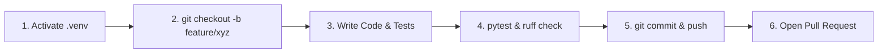

# 🚀 Developer Setup Guide

Welcome to the **BHSI Integration Platform**! This guide is designed to get you up, running, and contributing code in less than 10 minutes.

---

## ⚡ 5-Minute Quick Start (TL;DR)

If you already know Python and Git, here are the essential commands:

### On Windows (PowerShell):
```powershell
# 1. Clone the repository and enter the directory
git clone <repository-url>
cd xc

# 2. Create and activate a Python 3.11+ virtual environment
py -3.11 -m venv .venv
Set-ExecutionPolicy -Scope Process -ExecutionPolicy Bypass   # If script execution is blocked
.\.venv\Scripts\Activate.ps1

# 3. Upgrade pip and install dependencies
python -m pip install --upgrade pip
pip install -r requirements.txt
pip install -r requirements-dev.txt

# 4. Create your local environment configuration
Copy-Item .env.example .env

# 5. Install Git pre-commit hooks
pre-commit install

# 6. Start the API server
uvicorn app.main:app --reload
```

### On macOS / Linux (Terminal):
```bash
# 1. Clone the repository and enter the directory
git clone <repository-url>
cd xc

# 2. Create and activate a Python 3.11+ virtual environment
python3 -m venv .venv
source .venv/bin/activate

# 3. Upgrade pip and install dependencies
python -m pip install --upgrade pip
pip install -r requirements.txt
pip install -r requirements-dev.txt

# 4. Create your local environment configuration
cp .env.example .env

# 5. Install Git pre-commit hooks
pre-commit install

# 6. Start the API server
uvicorn app.main:app --reload
```

Open your browser to [http://127.0.0.1:8000/docs](http://127.0.0.1:8000/docs) — if you see Swagger UI, you are ready to code! 🎉

---

## 📋 Prerequisites Check

Make sure you have the following installed on your machine before proceeding:

| Tool | Minimum Version | How to verify in your terminal |
|---|---|---|
| **Python** | `3.11+` | `python --version` or `py --version` |
| **Git** | Latest stable | `git --version` |
| **VS Code** | Recommended editor | Download from [code.visualstudio.com](https://code.visualstudio.com/) |

> 💡 **Recommended VS Code Extensions:**
> - **Python** (by Microsoft)
> - **Pylance** (for IntelliSense and type checking)
> - **Ruff** (for automatic formatting and linting on save)

---

## 🛠️ Step-by-Step Walkthrough

### Step 1: Why a Virtual Environment (`.venv`)?
In Python, packages installed globally can conflict between different projects. A virtual environment is an isolated sandbox dedicated strictly to this project.

1. **Create the environment:**
   - **Windows:** `py -3.11 -m venv .venv`
   - **macOS/Linux:** `python3 -m venv .venv`
2. **Activate the environment:**
   - **Windows PowerShell:** `.\.venv\Scripts\Activate.ps1`
   - **macOS/Linux:** `source .venv/bin/activate`

> 🎯 **Success Check:**
> Your terminal prompt should now have `(.venv)` at the beginning, like this:
> ```text
> (.venv) PS C:\Projects\xc>
> ```

---

### Step 2: Install Project Dependencies

We separate dependencies into two files:
- **`requirements.txt`**: Packages needed to run the application (FastAPI, Pydantic, HTTPX, Uvicorn).
- **`requirements-dev.txt`**: Tools needed for development, testing, and formatting (Pytest, Ruff, MyPy, Pre-commit).

Run these commands inside your activated virtual environment:
```bash
python -m pip install --upgrade pip
pip install -r requirements.txt
pip install -r requirements-dev.txt
```

---

### Step 3: Local Configuration (`.env`)

The application loads environment variables (like API keys, URLs, and environments) from a local `.env` file.

1. Copy the template to create your `.env` file:
   - **Windows:** `Copy-Item .env.example .env`
   - **macOS/Linux:** `cp .env.example .env`
2. Open `.env` in VS Code. It will look like this:
   ```env
   APP_NAME=BHSI Integration
   ENVIRONMENT=development

   DUCK_CREEK_BASE_URL=TBC
   DUCK_CREEK_API_KEY=TBC
   ```
> ⚠️ **Important Security Rule:**
> **Never commit your `.env` file to Git!** It is included in `.gitignore` to protect real credentials and secrets from leaking into GitHub.

---

### Step 4: Install Pre-commit Hooks

Pre-commit runs automated code checks (like formatting and syntax checks) **automatically every time you run `git commit`**. This prevents broken code from being pushed to GitHub.

Run:
```bash
pre-commit install
```

Test that all hooks pass right now:
```bash
pre-commit run --all-files
```

---

## 🏃 Running the Application

Start the local development server with auto-reload enabled (the server automatically restarts whenever you save a file):

```bash
uvicorn app.main:app --reload
```

### 🔍 Interactive URLs to Test:
- **Interactive API Documentation (Swagger UI):**
  👉 [http://127.0.0.1:8000/docs](http://127.0.0.1:8000/docs)
  *(You can test all endpoints directly from this interactive web page!)*
- **Alternative API Documentation (ReDoc):**
  👉 [http://127.0.0.1:8000/redoc](http://127.0.0.1:8000/redoc)
- **Application Health Check:**
  👉 [http://127.0.0.1:8000/health](http://127.0.0.1:8000/health) — returns `{"status": "healthy"}`
- **Versioned API Health Check:**
  👉 [http://127.0.0.1:8000/api/v1/health](http://127.0.0.1:8000/api/v1/health)

Press `Ctrl + C` in your terminal anytime to stop the server.

---

## 🧪 Testing & Code Quality Cheat Sheet

Before committing or submitting a pull request, run these commands to make sure your code meets all project standards:

| Task | Command | What it does |
|---|---|---|
| **Run All Tests** | `pytest` | Runs all unit and integration tests |
| **Check Code Formatting** | `ruff format --check .` | Checks if your code follows formatting rules |
| **Auto-Fix Code Formatting** | `ruff format .` | Automatically formats all your files cleanly |
| **Lint Code for Errors** | `ruff check .` | Finds unused imports, syntax errors, and style issues |
| **Auto-Fix Lint Errors** | `ruff check . --fix` | Automatically fixes common linting issues |
| **Static Type Checking** | `mypy app tests` | Verifies Python type annotations (strict mode) |
| **Run All Pre-Commit Checks** | `pre-commit run --all-files` | Runs all configured checks at once |

> 💡 **Pro-Tip:** If your commit fails due to a formatting error, run `ruff format . && ruff check . --fix`, then stage the files with `git add .` and commit again!

---

## 🔄 Daily Developer Workflow

Here is the recommended workflow for developing a new feature or fix:



1. **Activate your environment:**
   - Windows: `.\.venv\Scripts\Activate.ps1`
   - Mac/Linux: `source .venv/bin/activate`
2. **Create a fresh feature branch:**
   ```bash
   git checkout -b feature/your-feature-name
   ```
3. **Write your code:** Make your changes and add tests in `tests/`.
4. **Verify quality locally:**
   ```bash
   pytest
   ruff check .
   ruff format --check .
   mypy app tests
   ```
5. **Commit your changes:**
   ```bash
   git add .
   git commit -m "Add policy adapter registry skeleton"
   ```
6. **Push and create a Pull Request (PR):**
   ```bash
   git push -u origin feature/your-feature-name
   ```

---

## ❓ Common Gotchas & Troubleshooting

### 1. Error: `running scripts is disabled on this system` (Windows)
- **Why it happens:** Windows PowerShell has a security policy restricting script execution by default.
- **How to fix it:** Run this command in your PowerShell window:
  ```powershell
  Set-ExecutionPolicy -Scope Process -ExecutionPolicy Bypass
  ```
  Then activate your `.venv` again.

---

### 2. Error: `py` or `python` is not recognized
- **Why it happens:** Python was installed without checking the "Add Python to PATH" box.
- **How to fix it:**
  1. Re-run the Python installer.
  2. Select **Modify**.
  3. Ensure **"Add Python to environment variables / PATH"** is checked and complete the install.
  4. Restart your terminal.

---

### 3. Error: `Address already in use` (Port 8000)
- **Why it happens:** An old server process is still running on port 8000.
- **How to fix it:**
  - Either start Uvicorn on a different port:
    ```bash
    uvicorn app.main:app --reload --port 8080
    ```
  - Or terminate the existing process using port 8000.

---

### 4. How do I know if my virtual environment is working?
Run:
```bash
python -c "import sys; print(sys.prefix)"
```
If the output ends with `.venv`, your virtual environment is active and working properly!

---

## 🤝 Need Help?
- Check [Understand.md](file:///Users/anujsingh/Documents/xc/Understand.md) for a plain-English explanation of the project architecture and layers.
- Check [README.md](file:///Users/anujsingh/Documents/xc/README.md) for endpoint details and project specifications.
- Reach out to your team lead or senior backend buddy if you run into any blockers!
